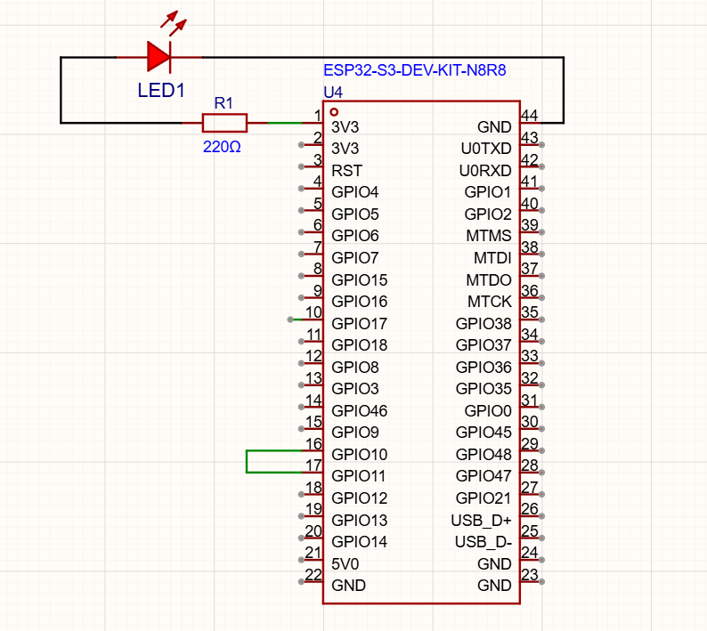
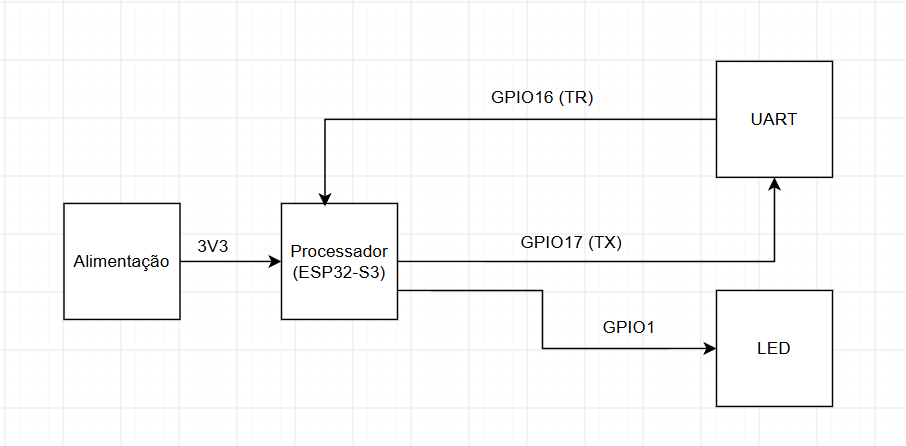

# Atividade 08: Comunicação Serial Assíncrona (UART) com Teste de Loopback

## Objetivo

Compreender o funcionamento básico do periférico UART (Universal Asynchronous Receiver-Transmitter) no ESP32 através da transmissão e recepção de dados em malha fechada (Loopback), validando o processamento de comandos recebidos para controle de periféricos em tempo real.

## Simulação no Wokwi

O projeto pode ser acessado e executado diretamente no Wokwi:

**[Acessar simulação no Wokwi](https://wokwi.com/projects/477899990114758657)**

## Diagramas

### Diagrama Esquemático

### Diagrama de Bloco

